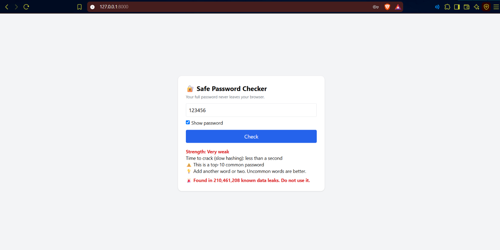
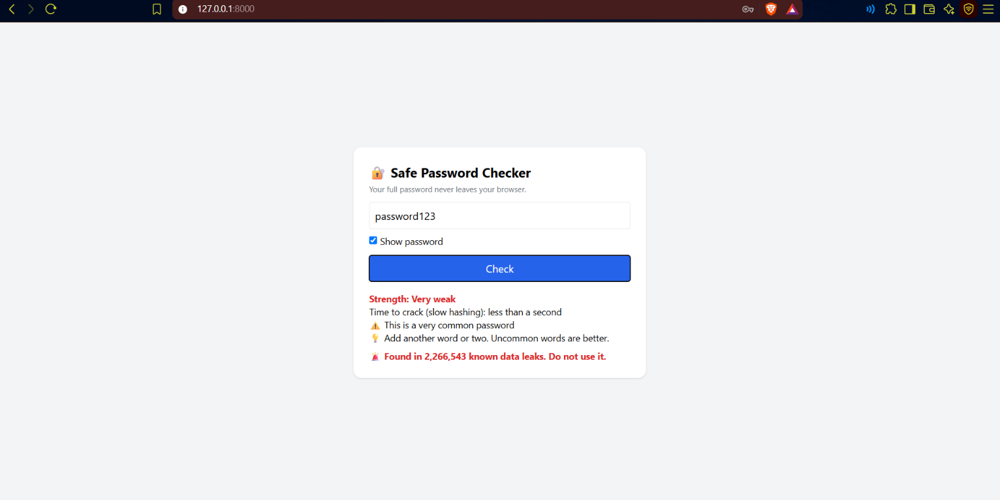
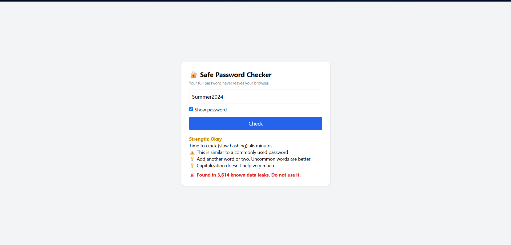
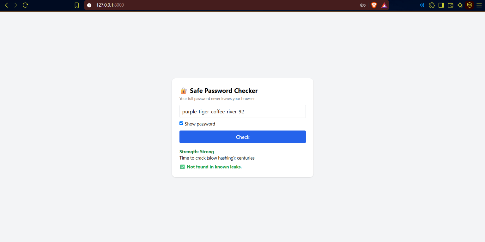

# 🔐 Safe Password Checker

A privacy-first password checker. It shows how strong a password is
and whether it appeared in known data leaks.
Your full password never leaves your browser.

## Problem
Many people use weak or leaked passwords. Most checkers ask you to send
your real password to a server, which is risky.

## How it works
1. Strength is checked in the browser with `zxcvbn`.
2. The browser makes a SHA-1 hash of the password.
3. Only the **first 5 characters** of the hash are sent to the backend (k-anonymity).
4. The backend asks the Have I Been Pwned (HIBP) range API and returns a list of matching hash endings.
5. The browser compares the rest of the hash locally.

So the backend and the API never see the full password or the full hash.

## Features
- Strength score with crack-time estimate
- Tips to improve the password
- Leak check using Have I Been Pwned
- Show / hide password option
- `Add-Padding` header used to hide the real response size

## Tech
Python, FastAPI, Requests, JavaScript (Web Crypto API), zxcvbn, Tailwind CSS

## Screenshots

**1. Very weak password:** `123456` is found in a huge number of leaks



**2. Common password:** `password123` is found in leaks



**3. Predictable pattern:** `Summer2024!` looks complex but is easy to guess



**4. Strong passphrase:** `purple-tiger-coffee-river-92` is strong and not found in leaks



## Run it
```bash
pip install -r requirements.txt
python -m uvicorn main:app --reload
```
Open `http://127.0.0.1:8000`

## Limitations
- It is a checking tool, not a password manager.
- Needs internet for the leak check.
- "Not found in leaks" does not mean a password is strong.
- Results for some passwords may vary.

## Future work
- Passphrase generator
- Bangla language support
- Check many passwords at once